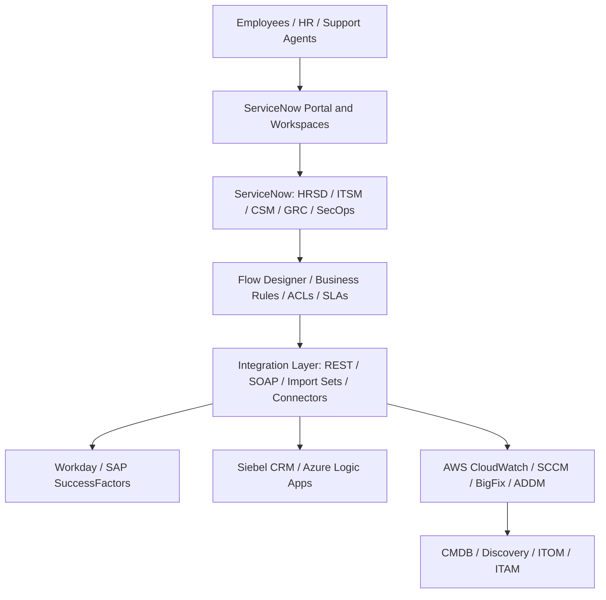
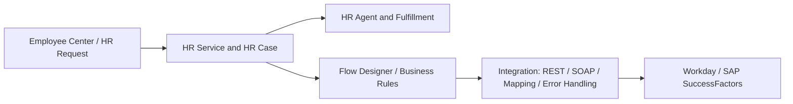
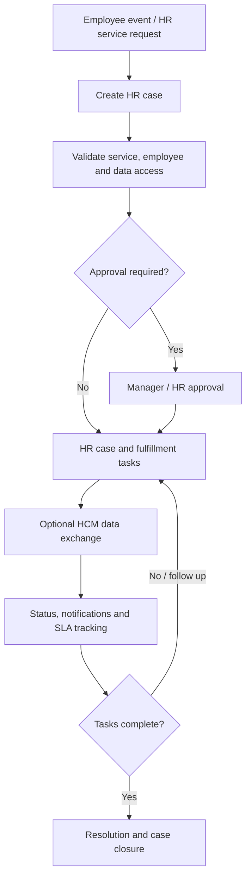
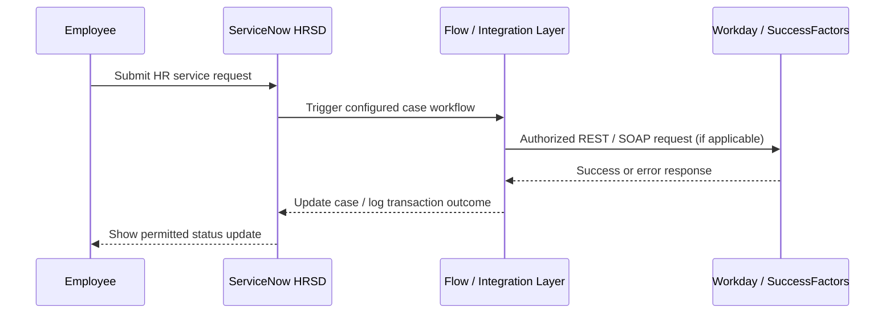
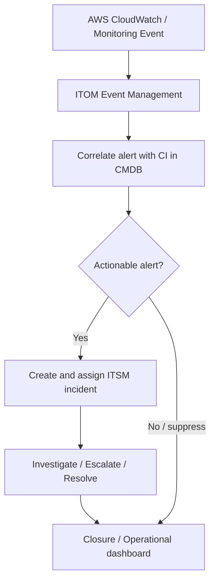
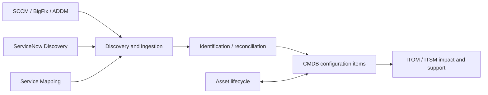
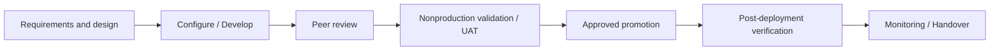

# ServiceNow Enterprise Service Delivery — Project Overview

> **Portfolio-style reconstruction (illustrative).** This README is adapted from the supplied *Uber ServiceNow Project* Word document. The engagement is described as **Uber Chicago (client) / Adecco Bangalore (company)**. The document explicitly states that its design is **not a verified client production architecture**. The six ServiceNow-style screenshots are **synthetic examples**, not live system captures. Original images have been extracted without modification.

## Contents

- [Overview](#overview)
- [Business objectives and module scope](#business-objectives-and-module-scope)
- [Enterprise architecture](#enterprise-architecture)
- [HRSD functional architecture](#hrsd-functional-architecture)
- [HRSD case lifecycle](#hrsd-case-lifecycle)
- [Workday / SAP SuccessFactors integration](#workday--sap-successfactors-integration)
- [ITOM to ITSM workflow](#itom-to-itsm-workflow)
- [ITAM / Discovery / CMDB](#itam--discovery--cmdb)
- [CSM, portals, and other modules](#csm-portals-and-other-modules)
- [Technical implementation inventory](#technical-implementation-inventory)
- [Security and release management](#security-and-release-management)
- [User acceptance testing](#user-acceptance-testing)
- [Reported outcomes and evidence](#reported-outcomes-and-evidence)
- [Handover checklist](#handover-checklist)
- [Image inventory](#image-inventory)

## Overview

This project description illustrates how ServiceNow could support enterprise service delivery across employee HR services, IT operations, customer support, risk, security and asset management. The main deep dive is **HR Service Delivery (HRSD)**, including employee onboarding workflows and interfaces with external Human Capital Management (HCM) systems.

The source describes **HRSD, ITSM, ITOM, ITAM, CSM, GRC/IRM, SecOps, Service Portal, CMDB, PPM, and TSOM**.

## Business objectives and module scope

| Workstream | Business objective described |
|---|---|
| **HRSD** | Employee HR service requests, HR case coordination and employee-data synchronization with Workday / SAP SuccessFactors. |
| **ITSM / ITOM** | Incident, problem, change and request handling; associate AWS CloudWatch events with affected configuration items and services. |
| **ITAM / Discovery** | Manage hardware and software lifecycles; improve inventory/discovery data from SCCM, BigFix and ADDM. |
| **CSM / Portal** | Customer self-service and cases; CRM integration through Siebel and Azure Logic Apps, with virtual assistance where appropriate. |
| **GRC / IRM / SecOps** | Risk assessments, compliance processes and security incident workflows. |
| **Platform operations** | Scripting, SLAs, import/update sets, reports, dashboards, PPM, TSOM, PowerShell DSC. |

## Enterprise architecture

The **original enterprise architecture diagram** from the Word document is preserved below.

**Architecture explanation:** Employees, HR agents and support teams access the ServiceNow portal and workspaces. The ServiceNow platform exposes business modules, while workflow and rule capabilities control request processing. Integration technologies connect ServiceNow to Workday / SuccessFactors, Siebel CRM / Azure Logic Apps, and AWS CloudWatch / inventory tooling. CMDB, Discovery, ITOM and ITAM consume or reconcile infrastructure data.

### Editable GitHub Mermaid overview

> Logical diagram only; interface directions and exact production deployment are not confirmed.

## HRSD functional architecture

HRSD enables employees to submit requests, HR agents to manage case fulfillment, and administrators to enforce permissions and workflow behavior.

| Actor | Illustrative responsibility |
|---|---|
| Employee | Raise HR requests, provide information, view permitted updates. |
| HR agent | Triage HR cases, manage assigned cases and tasks. |
| HR manager / approver | Handle exceptions or sensitive approvals where required. |
| Integration support | Monitor synchronized data, failures and retries. |
| Platform administrator | Maintain roles, ACLs, scripts, flow logic, logs and changes. |

### Screenshot 1 — HRSD employee onboarding case

The synthetic case form depicts an employee onboarding HR case, its current status, assignee and associated HR tasks. An HR case owner can review fulfillment progress and follow-up work.

## HRSD case lifecycle

### Original workflow diagram

### Editable workflow with approval and follow-up

| Step | Process | Evidence to capture |
|---|---|---|
| 01 | Employee selects an HR service, or an approved employee event triggers intake. | Service configuration / request form |
| 02 | ServiceNow creates and assigns the case with appropriate HR privacy protections. | HR case / COE assignment |
| 03 | Validate required data and decide whether an approval is needed. | Flow conditions / decisions |
| 04 | Assign and complete HR fulfillment tasks. | HR task records / execution details |
| 05 | Exchange required information with Workday or SuccessFactors where configured. | API configuration / sanitized logs |
| 06 | Send progress updates and track service targets. | Notifications / SLA records |
| 07 | Verify fulfillment and close the case with an audit trail. | Closed case / audit history |

### Screenshot 2 — Employee onboarding Flow Designer

The illustration shows a record-based onboarding trigger, condition checks, an approval branch and actions to create supporting tasks and initiate an HCM API call. Actual actions and branches require implementation verification.

### Screenshot 3 — Employee Center self-service portal

Employees can discover HR services, start onboarding, benefits or payroll requests, and monitor permitted request status through a common portal.

## Workday / SAP SuccessFactors integration

The source describes HRSD synchronization with HCM systems but **does not establish a single confirmed direction of data flow**. Each interface must document the authoritative system, mapping rules, trigger conditions and retry behavior.

### Screenshot 4 — REST message configuration

The synthetic REST configuration screenshot demonstrates an outbound API message, HTTP method, endpoint, authentication choice and request payload layout. The URL and field values shown are illustrative and should not be treated as verified endpoint specifications.

| Integration concern | Documentation / implementation consideration |
|---|---|
| Direction | Determine HRSD → HCM, HCM → HRSD or bidirectional for each transaction. |
| Authentication | Integration identities, credential storage, encryption and rotation. |
| Mapping | Employee IDs, statuses, service-specific fields, required/optional validations. |
| Resilience | Retry handling, deduplication, replay, idempotency and failed-event recovery. |
| Privacy | PII minimization, access controls, redacted logs, retention. |
| Monitoring | Correlation IDs, dashboards, alerts and support ownership. |

## ITOM to ITSM workflow

### Original event-to-incident workflow

### Screenshot 5 — ITOM event management

The event management illustration connects a monitoring event to a related configuration item (CI) and exposes incident-related actions. Correlation and creation rules should be validated against representative events.

## ITAM / Discovery / CMDB

The source describes CMDB data from **SCCM, BigFix, ADDM, Discovery and Service Mapping**, subject to reconciliation before teams rely on it for impact analysis. Asset management follows hardware/software from acquisition through retirement.

## CSM, portals, and other modules

**CSM** supports customer cases, portals and CRM connections such as Siebel and Azure Logic Apps. **HRSD** supports employees and must maintain separate case permissions and privacy protections. Virtual Agent may help route users to appropriate services.

### Screenshot 6 — CSM case management and dashboards

This synthetic view shows customer cases, case status and SLA/performance visualizations. It illustrates how support teams could monitor work queues and service levels.

Other workstreams described:

- **SecOps** — security incident investigations and response.
- **GRC / IRM** — risks, controls, compliance and assessments.
- **PPM** — project and portfolio tracking.
- **TSOM** — telecom service order coordination.

## Technical implementation inventory

| ServiceNow capability | Documentation artifacts |
|---|---|
| Client Scripts / UI Policies | Form validations, visibility conditions and client behavior matrix. |
| Business Rules / Script Includes | Server-side triggers, reusable logic and invocation conditions. |
| UI Actions | Action visibility, required permissions and record transitions. |
| Flow Designer | Triggers, actions, data inputs, exception paths and execution history. |
| REST / SOAP | API contracts, authentication, transforms and sanitized payloads. |
| Import Sets / Update Sets | Mapping, environment promotion and rollback steps. |
| CMDB / Discovery | CI class mapping, discovery sources and reconciliation results. |
| SLAs / Dashboards | SLA definitions, breach notification rules, KPIs and reports. |

## Security and release management

- Implement role-based and record/field-level access, especially for confidential HR cases.
- Keep credentials in approved protected stores and avoid leaking PII in logs and screenshots.
- Use controlled changes, nonproduction testing, approvals and documented rollback procedures.
- Before publication, ensure screenshots are synthetic or authorized and redacted and that project/client descriptions may be shared.

### Illustrative release workflow

## User acceptance testing

| Scenario | Expected outcome |
|---|---|
| HR case intake | Correct HR service, assignment and confidentiality controls. |
| HCM integration success | Correct mapping and transaction processing, without duplicates. |
| HCM endpoint unavailable | Retry/error queue, actionable logging and recoverable processing. |
| Unauthorized HR case access | ACL blocks confidential records and fields. |
| CloudWatch alert received | Correct CI correlation and incident-policy evaluation. |
| CSM self-service request | Only authorized users see customer-specific context. |
| ITAM reconciliation | Conflicting source records handled under approved rules. |

## Reported outcomes and evidence

The Word document lists the following **resume-reported outcomes**, without underlying measurements. They should not be represented as independently verified production results.

| Reported outcome | Evidence needed for validation |
|---|---|
| **30%** reduction in manual HR effort | Baseline and post-implementation handling time/manual touches and measurement period. |
| **40%** fewer scripting/workflow errors | Defined error metric and comparable production defect records. |
| **25%** reduction in CSM resolution time | Comparable ticket cohorts, median/mean resolution times and dates. |

## Handover checklist

- [ ] Confirm installed applications, plugins and historical release/version.
- [ ] Validate HR service catalog and data-flow direction per HCM transaction.
- [ ] Replace illustrative diagrams where approved actual designs exist.
- [ ] Add approved redacted production screenshots only if publication is authorized.
- [ ] Attach permitted API contracts, field mapping, ACL matrix and SLA rules.
- [ ] Identify module owners, monitoring responsibilities, support queues and runbooks.
- [ ] Review confidentiality, privacy and publishing approvals.

## Image inventory

All nine image files below are **unmodified image assets extracted from the uploaded Word document**. Six are synthetic ServiceNow-style screenshots; three are architecture/workflow diagrams.

| File | Content | Classification |
|---|---|---|
| `assets/enterprise-architecture.png` | Enterprise logical architecture | Original diagram |
| `assets/hrsd-case-workflow.png` | HR case lifecycle | Original diagram |
| `assets/itom-itsm-workflow.png` | ITOM to ITSM event workflow | Original diagram |
| `assets/hrsd-onboarding-case.png` | HR case form and tasks | Synthetic screenshot |
| `assets/flow-designer-onboarding.png` | Onboarding flow | Synthetic screenshot |
| `assets/employee-center-portal.png` | Employee Center | Synthetic screenshot |
| `assets/hcm-rest-integration.png` | HCM REST message | Synthetic screenshot |
| `assets/itom-event-management.png` | ITOM event and CI | Synthetic screenshot |
| `assets/csm-case-dashboard.png` | CSM cases and metrics | Synthetic screenshot |

### Usage

Keep `README.md` and `assets/` in the **same GitHub repository folder structure**. GitHub displays Mermaid diagrams automatically and renders the local image links when the referenced assets are committed.
