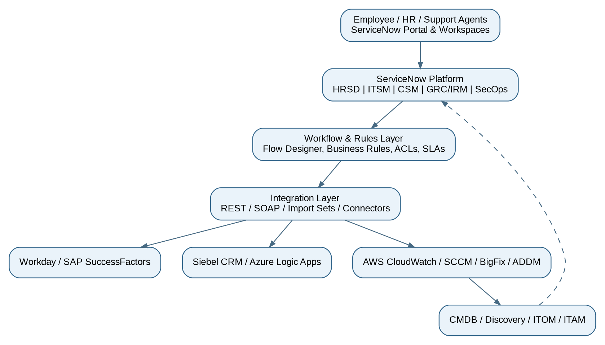
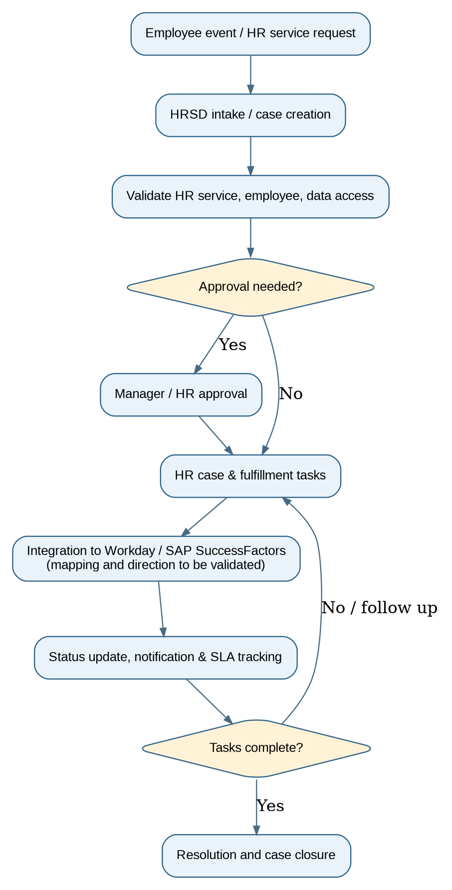
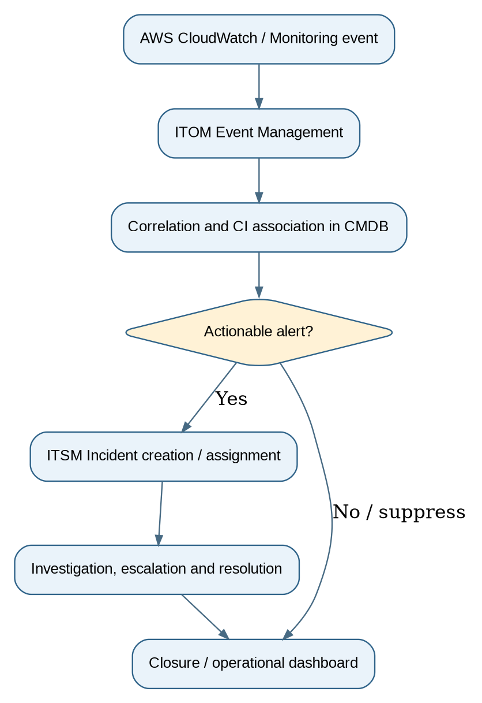
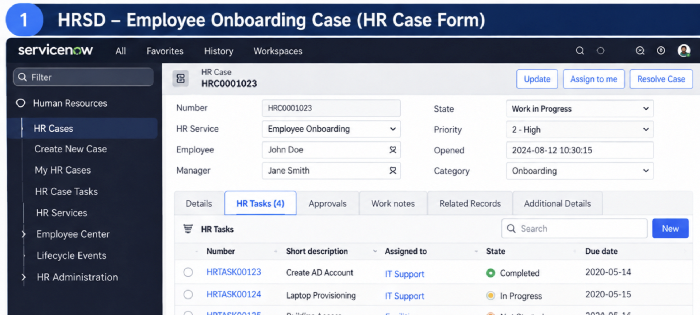
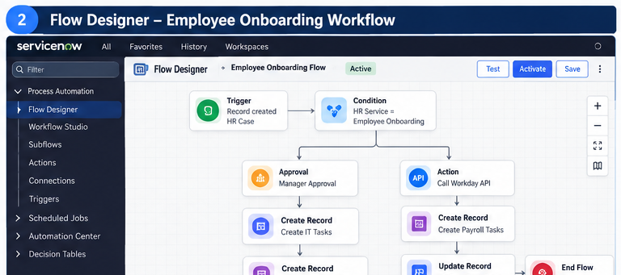
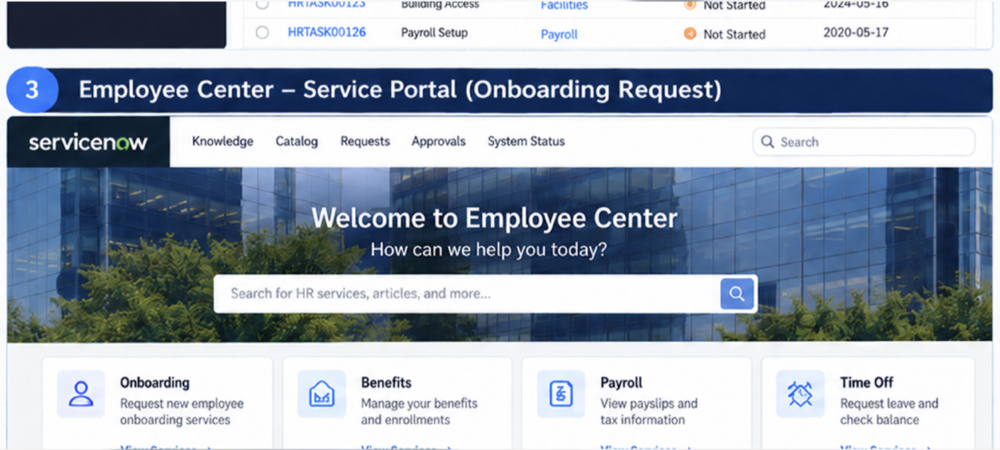
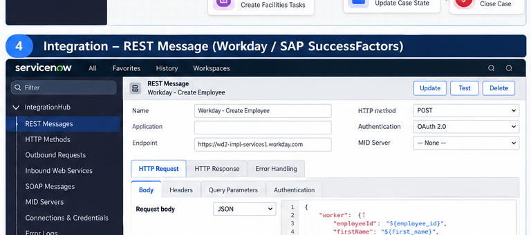
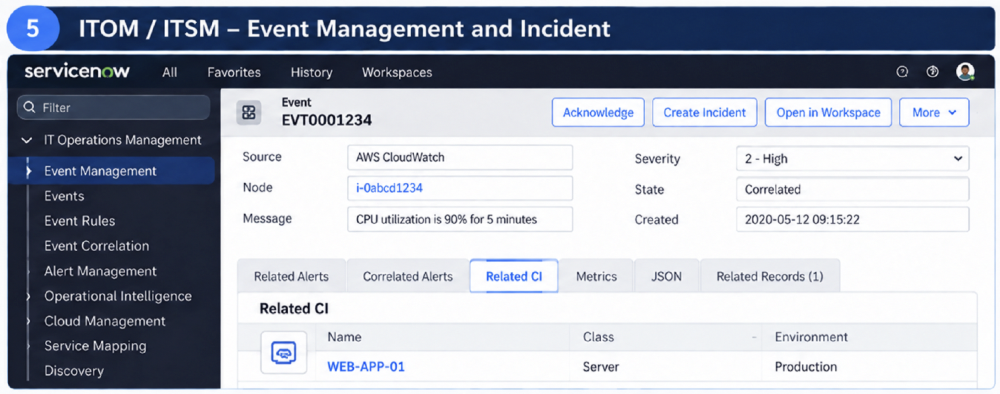
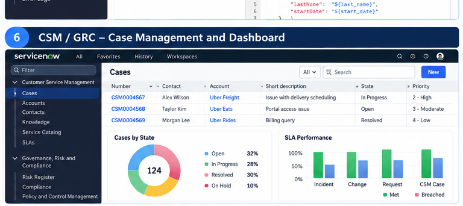

# ServiceNow Enterprise Service Delivery

| Document field | Details |
| --- | --- |
| Modules | HRSD, ITSM, ITOM, ITAM, CSM, GRC/IRM, SecOps, Service Portal, CMDB, PPM, TSOM |
| Primary deep-dive | HR Service Delivery (HRSD) and HR integrations |
| Document status | Portfolio-style reconstruction based on resume; not verified client internal design |
| Screenshots | Six labeled synthetic ServiceNow-style examples are included; no live system captures were provided. |

## 1. Executive summary

This project focuses on implementing and enhancing the ServiceNow platform to streamline enterprise service management processes across multiple modules, including HR Service Delivery (HRSD), IT Service Management (ITSM), IT Operations Management (ITOM), IT Asset Management (ITAM), Customer Service Management (CSM), and Configuration Management Database (CMDB).

The primary objective is to automate business workflows, improve service delivery, reduce manual effort, and integrate ServiceNow with external systems such as Workday, SAP SuccessFactors, AWS CloudWatch, and other enterprise applications.

The implementation includes developing Business Rules, Client Scripts, Script Includes, Flow Designer workflows, REST/SOAP integrations, approval processes, and automated notifications. It also involves configuring Service Portal functionality, managing access controls, monitoring service performance, and maintaining accurate asset and configuration data.

Overall, the project aims to provide a centralized, scalable, and efficient service management solution that improves operational efficiency, enhances user experience, and supports seamless communication between business teams and enterprise systems.

## 2. Business objectives and scope

| Workstream | Business objective / implementation described |
| --- | --- |
| HRSD | Provide a straightforward way for employees to raise HR requests, work with an HR agent, and keep Workday or SuccessFactors information in sync. |
| ITSM / ITOM | Make incidents, changes, problems, and requests easier to manage; connect CloudWatch alerts to the right services and configuration items. |
| ITAM / Discovery | Keep track of hardware and software through their lifecycle and improve discovery data from SCCM, BigFix, and ADDM. |
| CSM / Portal | Help customers submit and track support requests through a portal, with CRM integrations and virtual assistance where appropriate. |
| GRC / SecOps | Risk assessments, compliance workflows, security incident automation |
| Platform operations | ServiceNow scripts, SLAs, import/update sets, reporting, dashboards, PPM, TSOM and PowerShell DSC |

## 3. High-level logical architecture

The diagram below brings the main platforms and integrations together in one view. It is intended to explain how the pieces fit, not to reproduce  historical deployment or actual network layout.

 

## 4. HRSD module: functional design

The HRSD work focused on making employee services easier to request, manage, and track. HR cases provided a place to coordinate requests, while integrations with Workday and SAP SuccessFactors helped exchange employee information. Before implementing the design, the team would need to confirm which system owned each field and when updates should be sent.

### 4.1 Actors and responsibilities

| Actor | Typical responsibility (illustrative) |
| --- | --- |
| Employee | Submit HR request, view permitted updates, provide requested details |
| HR agent | Triage and manage assigned HR cases and fulfillment tasks |
| HR manager / approver | Review exceptions or sensitive requests when configured |
| Integration support | Monitor data sync, failure queues and retries |
| Platform administrator | Maintain roles, ACLs, flows, scripting, logging and changes |

### 4.2 HRSD workflow diagram

### 4.3 HRSD step-by-step flow

| Step | Functional flow | Evidence to capture |
| --- | --- | --- |
| 01 | An employee starts the process by selecting an HR service, or an approved employee event starts it automatically. | HR service configuration / intake form |
| 02 | ServiceNow opens the case, routes it to the right HR team, and applies the necessary privacy rules. | HR case record / COE assignment |
| 03 | The flow checks that required information is present and decides whether approval is needed. | Flow Designer decision branches |
| 04 | The right teams receive tasks, such as checking records or completing a service request. | HR tasks / execution details |
| 05 | Where configured, the system exchanges the needed information with Workday or SAP SuccessFactors. | REST/SOAP endpoint configuration; sanitized logs |
| 06 | The employee and HR team receive updates while the case progresses against its service targets. | Notifications / SLA records |
| 07 | Once the work is verified, the case is closed with an audit trail of what happened. | Closed case with audit trail |

### 4.4 HRSD integration contract checklist

| Area | Documentation required |
| --- | --- |
| Interface direction | HRSD → HCM, HCM → HRSD, or bidirectional: confirm separately for each transaction |
| Authentication | Integration account, credential store, encryption, secret rotation |
| Field mapping | Employee ID, employment status and service-specific fields; define required/optional |
| Resilience | Retries, deduplication, replay, idempotency, failed-event handling |
| Privacy | PII minimization, field ACLs, logging/redaction and retention |
| Monitoring | Transaction correlation IDs, integration dashboards and support ownership |

## 5. Other module workflows

### 5.1 ITOM events to ITSM incidents

### 5.2 Asset, Discovery and CMDB flow

Accurate asset and configuration data helps support teams understand what is installed, who owns it, and which services may be affected. In this design, SCCM, BigFix, ADDM, Discovery, and Service Mapping contribute information that must be reconciled before it is relied on in the CMDB. The asset process then follows equipment or software from acquisition through retirement.

### 5.3 CSM and employee portal experiences

Customer-facing support and employee HR support solve different problems. CSM supports customer cases, self-service, and CRM connections such as Siebel and Azure Logic Apps. HRSD handles employee matters with tighter privacy requirements. Both can offer a simple portal experience, but their case records and access rules should remain separate. Virtual Agent can guide users to the right service.

### 5.4 SecOps, GRC/IRM, PPM and TSOM

The wider program also included security response, governance, project tracking, and telecom service workflows. SecOps can coordinate security investigations, GRC/IRM can track risks, controls, and assessments; PPM can provide a view of active projects, and TSOM can coordinate telecom service orders. Each stream needs its own approved process and ownership model.

## 6. Technical implementation inventory

| ServiceNow capability | Example project documentation artifact |
| --- | --- |
| Client Scripts / UI Policies | Form validations, visibility rules, client behavior matrix |
| Business Rules / Script Includes | Trigger conditions, server-side logic, reusable functions |
| UI Actions | Permissions, workflow transitions and action visibility |
| Flow Designer | Trigger, steps, data pills, error handling, flow execution history |
| REST / SOAP | API contract, authentication, transforms, payload examples |
| Import Sets / Update Sets | Transformation mappings, promotion and rollback procedures |
| CMDB / Discovery | CI class mapping, data sources, reconciliation evidence |
| SLAs / Dashboards | Start/stop conditions, breach alerts, KPIs and report definitions |

## 7. Security and release management

Because HR cases may include confidential employee information, access should be granted only to people who need it. Review roles and ACLs by module, store integration secrets securely, and avoid exposing personal data in logs or screenshots. Promote configuration changes through an approved process, test them in a non-production instance, and document rollback steps.

## 8. Project Implementation and Workflow Overview

**A. Reviewing an employee onboarding case and its HR task**

A case owner can review the request, see the assigned HR tasks, and follow progress. A real capture should display only test or redacted employee details.

**B. How an employee onboarding request moves through the workflow**

The flow brings together the key steps of onboarding, including checks, approvals, task creation, and status updates.

**C. Employee self-service: submitting and tracking HR requests**

Employees can use a single portal to find HR services, submit requests, and check how their cases are progressing.

**D. Connecting ServiceNow HRSD with Workday and SAP SuccessFactors.**

The integration connects HR requests with employee information held in the HCM systems. The project team would define the fields to exchange, handle failed requests, and confirm updates are processed correctly.

The HRSD-to-HCM integration helps keep relevant employee information aligned across systems. The implementation should document which system owns each field, when updates are exchanged, and how the team checks and resolves failed transactions.

**E. From CloudWatch alerts to CMDB records and incidents**

Monitoring teams can trace an alert back to a configuration item and decide whether it needs an incident. Correlation and incident rules should be tested with sample events.

**F. Tracking customer service cases and service performance**

Support teams use case lists and dashboards to follow open requests, spot delays, and monitor response targets.

## 9. UAT and operational testing matrix

| Scenario | Expected outcome |
| --- | --- |
| HR case intake | Correct HR service, ownership, HR privacy and assignment |
| HCM integration succeeds | Mapped data and transaction log synchronized without duplicates |
| HCM endpoint unavailable | Retry/error queue, actionable logging and safe recovery |
| Unauthorized user views HR case | ACL denies confidential record/field access |
| CloudWatch alert received | Alert correlated with correct CI and applicable incident policy |
| CSM self-service request | Customer context visible only to appropriate authorized users |
| ITAM reconciliation | Conflicting inventory records handled according to agreed rules |

## 10. Metrics and evidence

| Reported metric | Evidence needed for credible project documentation |
| --- | --- |
| 30% lower manual HR effort | Before/after handling-time or manual-touch baseline and time period |
| 40% fewer scripting/workflow errors | Definition of error and comparative production defect records |
| 25% lower CSM ticket resolution time | Comparable ticket population, median/mean time and dates |

## 11. Implementation and handover checklist

- Confirm actual scoped applications, installed plugins and historical release/version
- Confirm employee HR services and HCM integration data flow directions
- Attach approved API specifications, mappings, ACL matrix and SLA definitions
- Identify module owners, monitoring responsibilities, support queue, and runbooks
- Review security, privacy, and client confidentiality before public or portfolio sharing
